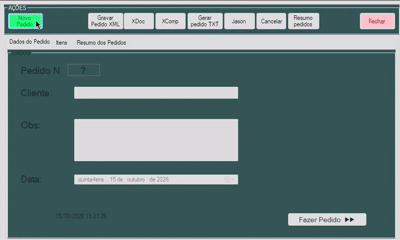
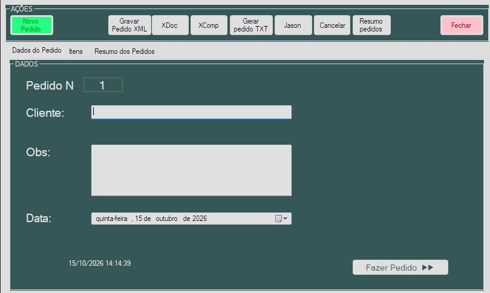
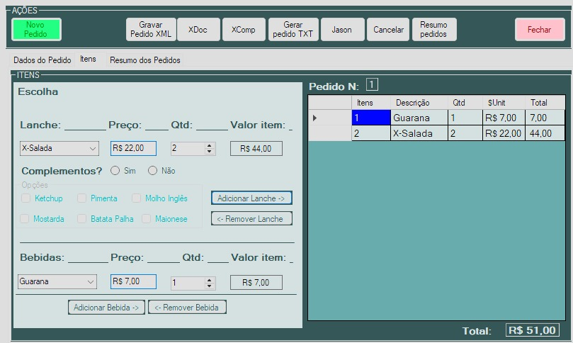

# 🍔 Lanchonete Sabida

> Sistema desktop de registro de pedidos para lanchonete, feito em C# com Windows Forms.




## 📌 Sobre
Projeto acadêmico desenvolvido com o objetivo de criar um aplicativo Windows Form para agilizar registros de pedidos. 
Foi realizado com o objetivo de aprimorar conhecimentos no desenvolvimento de sistemas e aprendizagem de funcionalidades da linguagem C#, 
como validações dos campos, ações de botões, DataGrids, além de aprender melhor sobre Programação Orientada a Objetos (POO).

## ✨ Funcionalidades
- [x] Abertura de novo pedido com número e data/hora
- [x] Cadastro de lanches e bebidas com quantidade e cálculo de total
- [x] Complementos opcionais por lanche
- [x] Gravação de conteúdo em arquivo XML

## 🖼️ Telas
| Dados do pedido | Itens | Resumo |
|---|---|---|
|  |  |  |

## 🛠️ Tecnologias
- C# · Windows Forms · .NET Framework 4.8
- LINQ to XML / `XmlWriter` para persistência

## ▶️ Como executar
**Pré-requisitos:** Windows, Visual Studio 2022 (carga de trabalho
*Desenvolvimento para desktop com .NET*) e .NET Framework 4.8.

```bash
git clone https://github.com/mths09/lanchonete-sabida.git
```
1. Abra `LanchoneteSabida.sln` no Visual Studio.
2. Pressione `F5`.

Ou baixe o executável na aba **Releases**.

## 🗂️ Estrutura do projeto
```
LanchoneteSabida/
├── Form1.cs            # lógica da tela
├── Form1.Designer.cs   # layout gerado pelo Designer
├── Program.cs          # ponto de entrada
└── Properties/
```

## 📋 Regras de negócio
- Cada pedido recebe um número sequencial.
- Complementos só são habilitados para lanches.
- Adiciona e Remove lanches e bebidas.
- Calcula o valor total dos pedidos.
- Não permite criar pedido sem usar o botão "Novo Pedido".

## 🗺️ Roadmap
- [ ] Gravação de pedidos em XML estável
- [ ] Tela de resumo dos pedidos
- [ ] Exportação em TXT/JSON
- [ ] Testes automatizados
- [ ] Migração para .NET moderno

## 📚 Aprendizados
Neste projeto, aprendi muitas funcionalidades novas em C#, como a manipular melhor os eventos dos objetos e o que cada um faz.
Aprendi também sobre como manipular os dados em um DataGridView, como adicionar via botão e também como removê-los.
Entendi como funciona melhor o tratamento de dados recebidos e como adicionar dados automaticamente nos campos por meio dos eventos.
Além disso também vi uma nova funcionalidade, utilizando  `XmlWriter`.

## 👤 Autor 
**Matheus Ferenci Miranda Leitão** 
· [LinkedIn](https://www.linkedin.com/in/matheus-ferenci-miranda-leit%C3%A3o-a611b9374/) 
· [Portfólio](https://github.com/mths09/lanchonete-do-saber) 
· matheusferenci0@gmail.com

## 📄 Licença
Distribuído sob a licença MIT. Veja [LICENSE](LICENSE).
